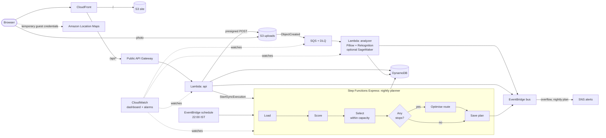

# SmartWaste

Predicts which bins will overflow by morning, then plans the shortest truck route that reaches the urgent ones first.

Residents photograph a bin. A cloud pipeline estimates how full it is, updates the forecast, and warns the crew if it will overflow. Every night a workflow ranks all bins by priority, fills the truck, orders the stops and puts the route on the collector's task list.

Built for the WeMakeDevs x AWS hackathon, **Ship It** track. The AWS deployment is deferred while the MVP is developed and tested locally.

## Current interface

The gateway offers two workspaces: **Report & Upload** for residents and volunteers, and **Field Operations & Dispatch** for collection teams. The selected gateway photo expands with its panel and remains as a faint background behind the workspace content. The SmartWaste logo stays centered at the top of the gateway.

In Report & Upload, users select a bin on the map, then upload a photo or choose a sample image to estimate its fill level. Map markers show the place name on hover or keyboard focus. The map and photo report are placed before the overflow and priority summaries so the main reporting actions are easy to reach.

The sample bin locations are illustrative points in a Bengaluru demo neighborhood, not real collection addresses. The AWS map uses Amazon Location; local runs use the built-in sample map unless AWS map configuration is present.

## What runs on AWS



| Ship It category | Services used | Where |
|---|---|---|
| Serverless | Lambda, API Gateway (HTTP API), Step Functions (Express) | `api`, analyzer and planner Lambdas; nightly planner workflow |
| Data and search | DynamoDB, S3 | single table with one GSI; site bucket and photo bucket |
| Access | Public API | no account or login required; both consoles and API routes are open |
| The plumbing | CloudFront, EventBridge, SQS, SNS, CloudWatch, Route 53 (optional), Amazon Location Maps | one front door for site and API; schedule and event bus; photo queue with dead-letter queue; alerts; dashboard and 4 alarms; real basemap with bin and route overlays |
| Agents and AI | Rekognition today, SageMaker endpoint optional | Rekognition turns away photos that are not a bin. If `SAGEMAKER_ENDPOINT` is set, the analyzer asks it for the fill level first and falls back to the built-in estimator |

No servers, no VPC, no NAT. Map tiles are billed by Amazon Location usage; the browser role is limited to read-only map rendering.

### How the three main flows work

**A resident reports a bin.** The page asks the API for an upload slot. The API creates a pending report in DynamoDB and returns an S3 presigned POST that fixes the key, the content type and an 8 MB size cap. The browser sends the photo straight to S3. S3 notifies SQS, the analyzer Lambda picks it up, checks the photo with Rekognition, estimates the fill level, updates the bin with an optimistic version check and publishes an `OverflowRisk` event if the forecast crosses 100%. The page polls the report until it reads `done`. A photo that is not a bin is rejected with a reason and leaves the bin untouched. A photo that fails three times lands in the dead-letter queue and raises an alarm.

**The nightly plan.** EventBridge starts the Step Functions workflow at 22:00 India time. The workflow loads bins and settings, scores each bin, picks bins in priority order until the truck is full, and, only if there is anything to collect, optimises the stop order. It saves the plan, emits `PlanReady`, and a rule emails the crew. Any failed step publishes to SNS and fails the execution. The collector console runs the same workflow on demand and gets the plan back synchronously.

**Access.** The MVP has no login or role checks. Anyone who can reach the site can report bins, upload photos, change shared planner settings, run collections and reset the shared demo data.

## Deploy after the MVP

AWS deployment is intentionally postponed until the MVP is ready. Local development and demos do not require AWS credentials. When deployment is approved, the CDK scripts below deploy the static frontend, API and supporting services.

Run deployment from your own computer with the AWS CLI configured for the account and region you intend to use. Node 20+ and Python 3.9+ are also required. On Windows, use WSL or Git Bash.

```bash
# from the project directory on your computer
export ALERT_EMAIL=you@example.com            # optional: overflow and nightly-plan emails
scripts/deploy.sh
```

The script runs the backend tests, builds the Pillow layer for Lambda, bootstraps CDK, deploys, prints the **live URL**, and runs the smoke test without requiring a SmartWaste login. AWS CLI credentials are still required. Expect 8 to 12 minutes the first time, mostly CloudFront.

After deploying:

| Task | How |
|---|---|
| Check the live site | `python3 scripts/smoke.py <url> --reset` |
| Watch it | The `DashboardUrl` output opens the CloudWatch dashboard |
| Get email alerts | Confirm the SNS subscription email AWS sends to `ALERT_EMAIL` |
| Custom domain | `DOMAIN_NAME=waste.example.com HOSTED_ZONE_NAME=example.com scripts/deploy.sh` (needs a Route 53 zone, forces us-east-1) |
| Pick a region | `AWS_REGION=ap-south-1 scripts/deploy.sh`. Defaults to your CLI region, else us-east-1. A custom domain forces us-east-1 |
| Quick S3-only demo | `scripts/deploy-s3-only.sh` hosts just the front end on S3 website hosting (HTTP, offline demo, no sign-in). `--destroy` removes it |
| Remove everything | `scripts/destroy.sh` |

## Run it locally with no AWS

```bash
python3 dev/server.py            # http://localhost:8787
```

The dev server serves the front end and runs the real Lambda handlers against in-memory stand-ins for DynamoDB, S3, Step Functions and Rekognition. This exercises the API and photo-report flow locally without AWS credentials. The application has no login; the local API is available to anyone who can reach the development server.

For a browser-only offline demo, run:

```bash
python3 dev/server.py --local  # http://localhost:8787
```

This omits `config.json`, so the frontend uses in-browser sample data and the built-in sample map. Changes in this mode are temporary and reset when the page is reloaded. Neither local mode deploys or writes data to AWS.

## Tests

```bash
pip install Pillow
python3 -m unittest discover -s backend/tests -p "test_*.py"
python3 dev/e2e.py && python3 dev/e2e_edge.py                    # browser tests, needs playwright + Chromium
```

The Python model and planner are a port of `frontend/engine.js`. `test_parity.py` runs both on five scenarios and requires identical bin scores, route order, distances and capacity decisions, so the browser and the cloud never disagree.

## What is real and what is not

- **Fill estimate.** The built-in estimator measures edge density on a 64x64 grey thumbnail. It separates empty, half and overflowing bins in clean photos and is a baseline, not a trained model. Rekognition screens out non-bin photos. The SageMaker hook is wired and tested against a stub, but no model is deployed, because there are no labelled bin photos to train on. Correcting a wrong detection is one tap, and corrections replace the original report instead of stacking.
- **Forecast.** Predicted fill is current fill plus fill rate times hours to collection. Fill does not yet grow by itself between reports.
- **Data and map.** One demo neighbourhood of 24 bins. The browser places illustrative points over a sample area in Bengaluru on an Amazon Location basemap. Bin place names appear on marker hover or keyboard focus. The map shows the real street basemap, but the sample bin positions are not surveyed addresses. Routes use Manhattan distance on the demo grid, not road-network directions; displayed route lines connect stops directly.
- **Not run in the authoring sandbox.** The CDK stack was written without access to npm or PyPI, so `cdk synth` and a real deploy have not been run. The stack file parses and its API routes match the backend route table exactly. The backend runs against faithful in-memory stand-ins, which check logic and DynamoDB expression shapes but not AWS itself. `scripts/smoke.py` is the check against the real thing: run it right after the first deploy. If `cdk deploy` reports a type error, it will point at a line in `infra/lib/smartwaste-stack.ts`.

## Security notes

Photo bucket and site bucket block all public access and enforce TLS. CloudFront reaches the site bucket with origin access control. The photo bucket accepts only presigned POSTs, with a fixed key, content type and size. Uploaded photos expire after 30 days. CloudFront adds a strict Content-Security-Policy, HSTS, frame denial and nosniff. API Gateway throttles at 50 requests per second. Lambda error messages never include internals. Pending uploads expire from DynamoDB after a day. The application API is intentionally public for this MVP; do not store sensitive data or deploy it for private operational use without adding access controls.

## Demo video script (3 minutes)

The judges score idea and impact, use of AWS, design, execution, and the video. One feature that works beats five that almost do, so show the loop end to end.

| Time | Show | Say |
|---|---|---|
| 0:00 | Gateway page, hover each side and a map marker | "Bins overflow because trucks go by schedule, not by need. SmartWaste predicts which bins need emptying tonight and routes the truck to them." |
| 0:20 | Open the reporter side, pick bin B-05, upload a photo | "A resident photographs a bin. The photo goes straight to S3 with a presigned URL." |
| 0:50 | Result card, priority jumps, then the CloudWatch dashboard | "S3 triggers SQS, a Lambda checks the photo with Rekognition, estimates the fill and updates DynamoDB. A dead-letter queue and alarms catch failures." |
| 1:20 | Collector side, run the planner | "Step Functions scores every bin, fills the truck, and only then optimises the route." |
| 1:50 | Map and route, play the truck, tick a stop | "9 of 24 bins, 5.7 km, 3.3 km shorter than visiting everything, every urgent bin covered." |
| 2:15 | Step Functions graph in the console, EventBridge rule, SNS email | "It also runs by itself every night at 22:00 and emails the crew." |
| 2:40 | Architecture diagram from this README | "All serverless, deployed with one command. CloudFront serves the site and the API." |

## Submission checklist

- Student verification on AWS Builder Center (required to compete)
- Live URL from `scripts/deploy.sh` output
- The 3-minute video above
- Optional: a blog post on AWS Builder Center, linked in the submission, for the extra prize

## Layout

```
frontend/   static site: index.html, styles.css, app.js (UI), api.js (API + offline backend), engine.js (model), assets/ (gateway photos)
backend/    Python 3.12 Lambdas in src/smartwaste, tests in tests/, in-memory AWS stand-ins in tests/fakeaws
infra/      AWS CDK app (TypeScript), one stack
scripts/    deploy.sh, destroy.sh, build-layer.sh, smoke.py
dev/        local server and browser tests
incoming_updates/  drop location for update ZIPs before applying their changes
```
